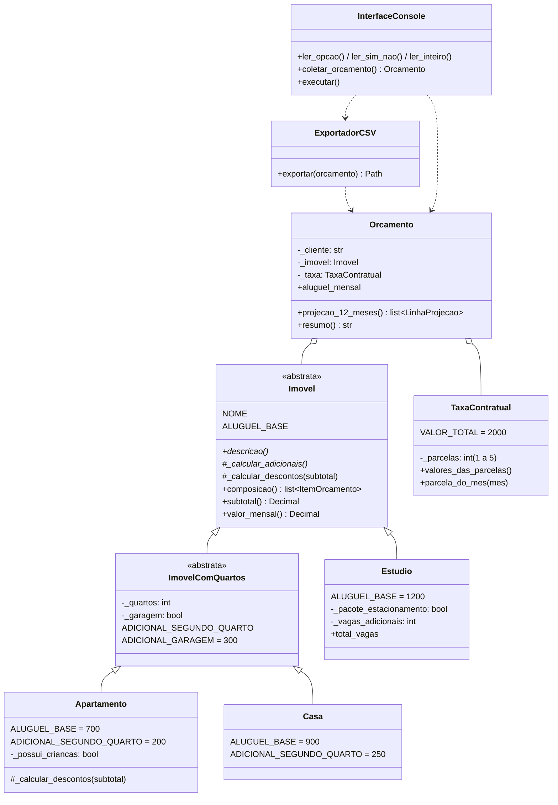

# RentSmart — Sistema de Orçamento de Locação

Aplicação em Python, orientada a objetos, que monta o orçamento de locação da **R.M Imóveis**
(cliente fictício): recebe as escolhas do cliente, valida, aplica as regras comerciais, mostra como
o aluguel foi formado, apresenta a taxa contratual separada do aluguel e gera um **CSV com a
projeção dos 12 primeiros meses**.

Trabalho da disciplina *Algorithmic Thinking & Introduction to Object-Oriented Programming* —
UniFECAF. Aluno: Eduardo Gomes Costa. Repositório: https://github.com/edugcfound/rentsmart

## Como executar

Requisito: **Python 3.10 ou mais novo** (testado no 3.14.6, Windows 10). Não usa nenhuma biblioteca
externa, então não precisa de `pip install`.

1. Abra o PowerShell (ou o terminal do VS Code) **na pasta do projeto** (a que tem o `main.py`).
2. Rode o programa:

   ```powershell
   python main.py
   ```

3. Responda às perguntas. No fim, o resumo aparece na tela e o CSV é salvo na pasta `saida/`.

Para rodar os testes automatizados (44 testes, biblioteca `unittest`, que já vem com o Python):

```powershell
python -m unittest discover -s tests -t . -v
```

## Exemplo de uso

```text
Nome do cliente: Ana Souza
Escolha o tipo de imóvel (1, 2 ou 3): 1
Quantos quartos? (1 ou 2): 2
Deseja vaga de garagem (R$ 300,00)? (S/N): S
O cliente possui crianças? (S/N): N
Taxa contratual de R$ 2.000,00. Em quantas parcelas? (1 a 5): 5
```

Trecho do resumo exibido (saída real em [`evidencias/01-...txt`](evidencias/01-apartamento-2q-garagem-sem-criancas-5x.txt)):

```text
1) COMPOSIÇÃO DO ALUGUEL MENSAL
  Aluguel-base (apartamento)                           R$ 700,00
  (+) Adicional: 2º quarto                             R$ 200,00
  (+) Adicional: 1 vaga de garagem                     R$ 300,00
  = Subtotal (base + adicionais)                     R$ 1.200,00
  (-) Desconto: 5% (cliente sem crianças)              -R$ 60,00
  ALUGUEL MENSAL                                     R$ 1.140,00
----------------------------------------------------------------
2) TAXA CONTRATUAL (cobrada à parte, NÃO faz parte do aluguel)
  Valor total da taxa                                R$ 2.000,00
  Parcelamento escolhido: 5x de R$ 400,00 sem juros
```

## Regras de negócio implementadas

| Regra | Valor |
|---|---|
| Aluguel-base: apartamento (1 quarto) / casa (1 quarto) / estúdio | R$ 700,00 / R$ 900,00 / R$ 1.200,00 |
| Apartamento com 2 quartos | + R$ 200,00 por mês |
| Casa com 2 quartos | + R$ 250,00 por mês |
| Vaga de garagem (casa ou apartamento) | + R$ 300,00 por mês |
| Estúdio: pacote inicial de estacionamento (2 vagas) | + R$ 250,00 por mês |
| Estúdio: cada vaga além do pacote | + R$ 60,00 por mês |
| Apartamento, cliente **sem** crianças | − 5% sobre o aluguel já com os adicionais |
| Taxa contratual (separada do aluguel) | R$ 2.000,00 em 1 a 5 parcelas |

Pontos que o enunciado não define e como foram resolvidos (lista completa em
[`docs/CHECKLIST.md`](docs/CHECKLIST.md), seção D):

- Estúdio não tem opção de 2 quartos nem a vaga de R$ 300; o estacionamento dele é só o pacote.
- Vagas adicionais do estúdio só existem junto com o pacote inicial.
- O desconto de 5% vale sobre base + 2º quarto + garagem ("após os adicionais").
- Sem juros no parcelamento. Quando a divisão não é exata, o centavo que sobra vai para as primeiras
  parcelas (3x = 666,67 + 666,67 + 666,66), para a soma dar exatamente R$ 2.000,00.
- Na projeção, a parcela *n* da taxa é cobrada no mês *n* do contrato.

## Arquivo CSV

Gerado em `saida/projecao_12_meses_<cliente>_<tipo>.csv`. Formato pensado para abrir direto no
Excel em português: separador `;`, vírgula decimal, UTF-8 com BOM.

| Coluna | Conteúdo |
|---|---|
| Mes | 1 a 12 |
| Aluguel mensal (R$) | aluguel já com adicionais e descontos |
| Parcela da taxa contratual (R$) | valor da parcela no mês (0,00 depois da última) |
| Parcela n. | `1/5`, `2/5`… ou `-` |
| Total do mes (R$) | aluguel + parcela da taxa |
| Total acumulado (R$) | soma dos meses até ali |

A última linha (`TOTAL`) traz o total de aluguel no ano, a taxa inteira e o total geral.
Exemplos reais gerados pelo programa estão em [`exemplos/`](exemplos/).

## Estrutura do projeto

```text
rentsmart/
├── main.py                    # ponto de entrada: python main.py
├── rentsmart/                 # pacote com as classes
│   ├── imoveis.py             # Imovel, ImovelComQuartos, Apartamento, Casa, Estudio, ItemOrcamento
│   ├── taxa_contratual.py     # TaxaContratual
│   ├── orcamento.py           # Orcamento, LinhaProjecao
│   ├── exportador_csv.py      # ExportadorCSV
│   ├── interface.py           # InterfaceConsole (perguntas e validação)
│   └── dinheiro.py            # arredondamento e formatação em R$
├── tests/                     # 44 testes automatizados (unittest)
├── docs/
│   ├── CHECKLIST.md           # requisitos do enunciado x onde foram atendidos
│   ├── fluxograma.svg / .png  # fluxograma da lógica
│   ├── parte-teorica/         # PDF da parte teórica (e o HTML que o gera)
│   ├── roteiro-video.md       # roteiro do vídeo pitch de até 4 minutos
│   └── O-QUE-FALTA-ENTREGAR.md # passos que só o aluno pode fazer
├── evidencias/                # saídas reais de execução e dos testes
├── exemplos/                  # CSVs reais gerados nos cenários de teste
└── saida/                     # onde o programa grava os CSVs (fora do git)
```

## Estrutura de classes



Conceitos de POO usados:

- **Classes e objetos:** cada orçamento é um objeto `Orcamento` que guarda um objeto de imóvel e um
  de `TaxaContratual`.
- **Encapsulamento:** os atributos ficam protegidos (`_quartos`, `_parcelas`…) e só mudam por
  *properties* que validam o valor. Não dá para criar uma casa com 3 quartos nem uma taxa em 6x.
- **Herança:** `Apartamento` e `Casa` herdam de `ImovelComQuartos` a regra do 2º quarto e da garagem,
  sem repetir código; todos herdam de `Imovel` o cálculo final.
- **Polimorfismo:** `valor_mensal()` é o mesmo método para qualquer imóvel, mas cada classe responde
  com os seus adicionais e descontos (só o `Apartamento` sobrescreve `_calcular_descontos`).
- **Abstração:** `Imovel` é abstrata (não pode ser instanciada); ela define o "contrato" que todo
  imóvel precisa cumprir.
- **Separação de responsabilidades:** regras de negócio (`imoveis`, `taxa_contratual`), montagem do
  orçamento (`orcamento`), arquivo (`exportador_csv`) e conversa com o usuário (`interface`) ficam em
  módulos diferentes. A interface recebe `input`/`print` por parâmetro, o que permite testá-la.

O fluxograma completo está em [`docs/fluxograma.png`](docs/fluxograma.png).

## Testes e evidências

- `tests/`: 44 testes cobrindo todas as regras, os limites das validações, a divisão da taxa, o
  conteúdo do CSV e a interface (com respostas simuladas, incluindo respostas inválidas).
- `evidencias/`: saída **real** do programa em 5 cenários (apartamento, casa, estúdio, entradas
  inválidas e dois orçamentos seguidos) e a saída real dos testes. Cada arquivo diz o comando, as
  entradas e a data em que foi executado.
